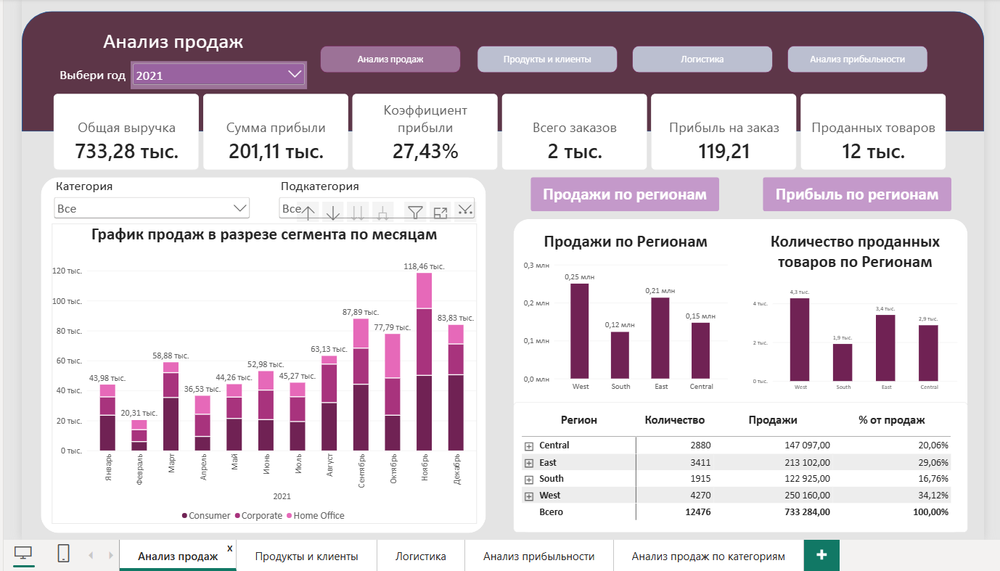
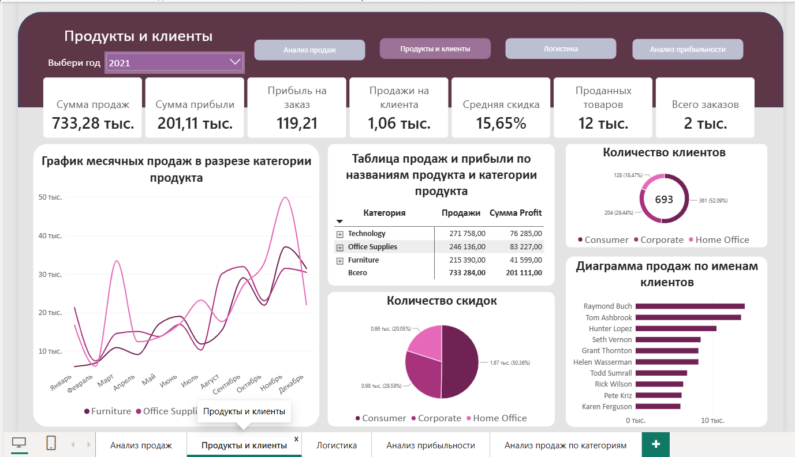
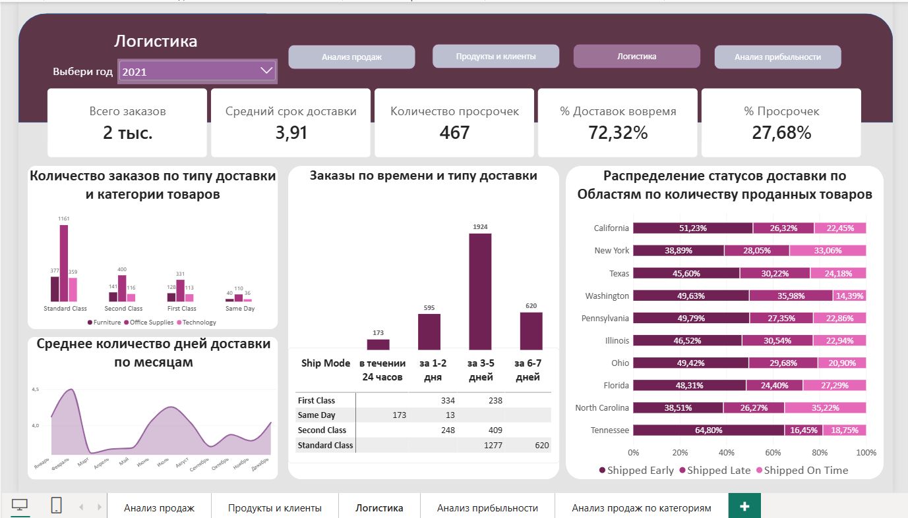
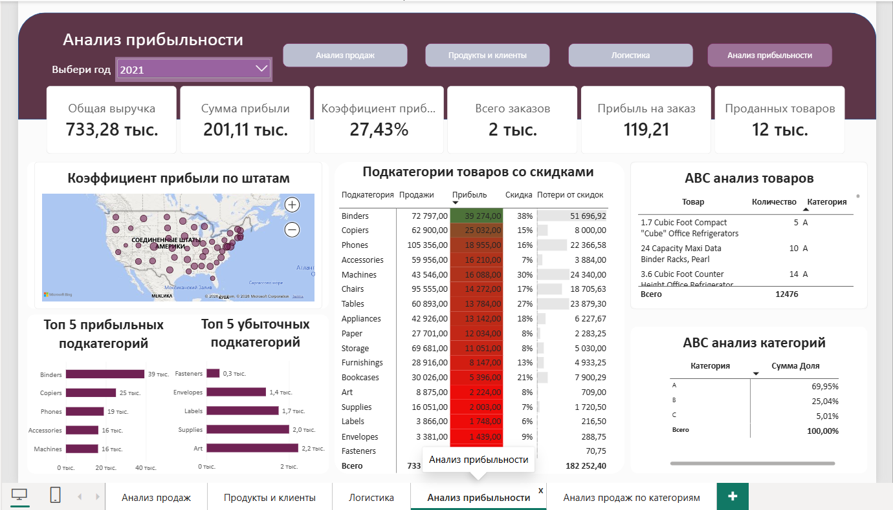

# power-bi-sales-dashboard
# Анализ продаж

Краткое описание: Разработала интерактивный дашборд для анализа продаж.

## 📊 Скриншоты дашборда

## 🛠️ Что было сделано:
- Подключены и очищены данные с помощью Power Query.
- Построена модель данных, настроены связи между таблицами.
- Написаны меры на DAX.
- Разработан интерактивный визуальный интерфейс.

## 📂 Как посмотреть проект:
Вы можете скачать файл `15. Мой отчет.pbix` из этого репозитория и открыть его в Power BI Desktop.

